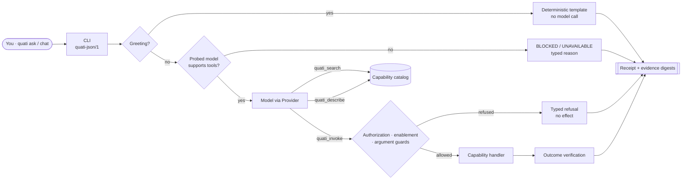
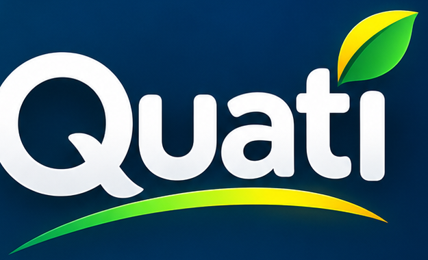

<p align="center">
  
</p>

<h1 align="center">Quati</h1>

<p align="center">
  <strong>An executive secretary that takes responsibility for work — not just a chat window in front of other agents.</strong>
</p>

<p align="center">
  
  
  
  
  
  
</p>

<p align="center">
  <a href="#what-quati-is">What it is</a> ·
  <a href="#quick-start">Quick start</a> ·
  <a href="#model-providers">Providers</a> ·
  <a href="#how-a-request-flows">Architecture</a> ·
  <a href="#live-qualification">Live qualification</a> ·
  <a href="#project-status">Status</a> ·
  <a href="#start-here-normative-reading-order">Docs</a>
</p>

---

## What Quati is

Quati interprets a request, starts safe work, asks only questions that are worth asking, manages
concurrent commitments, speaks up at the right moment, restores old context, checks outcomes and
hands specialist execution to interchangeable adapters.

It is designed to stay useful on **small, inexpensive models**. Stronger models are optional and are
used only for decisions that need them.

<table>
<tr>
<td width="50%" valign="top">

**🛡️ A protected kernel**

Prompts, operators and self-improvement agents can never switch these off:

- identity and tenant
- authorization **before** any effect
- durable commitments
- a transactional or reconcilable outbox
- evidence integrity and an audit trace
- versioned behavior policy

</td>
<td width="50%" valign="top">

**🔎 Capability discovery**

The model does not get a hard-coded tool list. Quati gives it four tools:

- `quati_search`
- `quati_describe`
- `quati_invoke`
- `quati_status`

The model finds the capability itself. Each call passes authorization, enablement and argument guards.

</td>
</tr>
<tr>
<td valign="top">

**🧾 Evidence**

Every answer carries a receipt. It records:

- the observed model identity
- the prompt, tool-schema, catalog, configuration, statechart and code digests
- the trajectory and cost

Nothing claims success without a verified outcome.

</td>
<td valign="top">

**🔌 Any model provider**

Choose a provider by name:

- the Anthropic API
- OpenAI or any OpenAI-compatible endpoint, such as OpenRouter
- the `claude`, `codex` and `gemini` command-line tools, under your own sign-in

To add another vendor, write a small subclass.

</td>
</tr>
</table>

> **Terminal first.** Every capability is exercised and accepted through the `quati` command line,
> including the conversational `quati chat` session. No GUI, web UI or full-screen TUI work starts
> until every slice gate S00–S07 passes.

## Quick start

```bash
python3.12 -m venv .venv && . .venv/bin/activate
pip install -e '.[test]'          # add '.[live]' for the Anthropic / OpenAI SDK transports

quati init                        # create a private LOCAL identity (no provider call)
quati doctor                      # configuration vs. measured provider support
quati config validate             # identity, policy, provider and behavior package checks
quati ask "hi!"                   # deterministic greeting, no model call
```

Connect a model. This example uses your own signed-in Claude Code, so Quati never sees a key:

```bash
export QUATI_PROVIDER=claude_cli QUATI_MODEL=haiku QUATI_ALLOW_LIVE=1
quati models probe                # measure tools / structured output / timeout support live
quati capabilities --help         # install the synthetic S00 fixture capabilities
quati ask "When is my next appointment?"
quati chat                        # line-based conversational session
quati trace show REQUEST_ID       # the recorded receipt and decisions of one request
quati trace explain REQUEST_ID    # which capability was selected and why the others were not
quati behavior validate examples/behavior/executive-secretary.yaml   # compile a behavior package
quati behavior render examples/behavior/executive-secretary.yaml     # its prompt preview and build receipt
```

Conversation rule in S00: Quati answers greetings and other social-only text with application-owned text and displays no model-written answers; anything else must end in a verified capability result, an honest "no capability" reply or a typed refusal.

All output is machine-readable `quati-json/1`: `status`, `data`, `error`, `evidence_refs`,
`next_action` and `uncertainties`.

## Model providers

| Transport | How it authenticates | Live status |
|---|---|---|
| `claude_cli` | the vendor's own `claude` executable, started with your sign-in; Quati holds no key | ⏳ qualified on an earlier code digest (`claude-haiku-5-5`, 30/30 and 30/30); requalification pending |
| `codex_cli` | the vendor's own `codex` executable, with your sign-in | ✅ transport verified live; `gpt-6-luna` scored 29/30, below the gate |
| `anthropic` | Anthropic SDK, using a secret reference (`QUATI_API_KEY_ENV`) | ⏳ not verified externally |
| `openai` / `openai_compatible` | OpenAI SDK with an approved HTTPS base URL (e.g. OpenRouter) | ⏳ not verified externally |
| `gemini_cli` | the vendor's own `gemini` executable | ⏳ not verified externally |

Every model call goes through the `Provider` base class. It owns configuration checks, budgets,
retries, output validation and the live feature probe. The vendor executables run in an empty
temporary directory with an allow-listed environment. They never receive a copy of Quati's
environment.

**Adding a vendor** takes one subclass. For example, Grok through its OpenAI-compatible API:

```python
from quati.application.providers import register
from quati.adapters.providers.openai_compatible import OpenAICompatibleProvider

@register
class GrokProvider(OpenAICompatibleProvider):
    transport = 'grok'
    default_base_url = 'https://api.x.ai/v1'
    needs_endpoint = False        # the default URL above is used when QUATI_BASE_URL is unset
```

```bash
export QUATI_PROVIDER=grok QUATI_MODEL=grok-4 QUATI_API_KEY_ENV=XAI_API_KEY QUATI_ALLOW_LIVE=1
```

To add a provider from a separate package, declare it under the `quati.providers` entry-point group.
To add a new wire protocol, subclass `Provider` directly and implement `_complete()`.

## How a request flows



| Layer | Path | Responsibility |
|---|---|---|
| Domain | `src/quati/domain/` | typed core concepts and pure reducers; no SDK, DB or transport imports |
| Application | `src/quati/application/` | use cases, ports, the `Provider` base and the discovery tools |
| Adapters | `src/quati/adapters/` | providers, ledger, identity, evidence, fixture capabilities |
| Behavior | `src/quati/behavior/` | compiled prompts, context envelopes and declarative statecharts |
| CLI | `src/quati/cli/` | presentation only |

## Live qualification

S00-GATE-02 requires a **real model** to choose the right capability from a natural-language
request, without any hint, in **30 of 30** runs on each test case.

> **The current code is not live-qualified.** The last accepted live run (30/30 on CAP-01 and 30/30 on CAP-02
> with `claude-haiku-5-5`) bound an earlier code digest. The source has changed since then, so that result
> does not transfer: requalification of the current code is pending. The table shows that earlier run.

| Case | What is tested | `claude_cli` · claude-haiku-5-5 (earlier code digest) |
|---|---|---|
| CAP-01 | choose the right capability among confusable ones | **30/30** (Wilson 95% LB 0.886) |
| CAP-02 | find the next appointment; write-capable decoys stay unused | **30/30** |
| CAP-03 | a disabled capability is never invoked | ✅ |
| CAP-05 | an unprobed model is refused | ✅ |
| SOC-01 | a greeting triggers no work | ✅ |

The deterministic oracle checks each run for:

- the search → describe → invoke order
- exact arguments
- no gold-label leakage into the prompt
- a recorded, randomized candidate order
- zero unauthorized effects

The model, prompt, schema, catalog, configuration, statechart and code digests are the same across
all runs. Every receipt Quati writes carries the code digest, and the harness refuses to start a run
whose receipts would not carry the pre-registered one.

Rerun the qualification (this spends real money on your sign-in):

```bash
.venv/bin/python tests/evals/run_live_eval.py --transport claude_cli --model haiku --estimate-only   # free: planned calls
.venv/bin/python tests/evals/run_live_eval.py --transport claude_cli --model haiku \
    --cases DOCTOR CAP-01 CAP-02 CAP-03 CAP-05 SOC-01 WRITE-01 --workers 4 --label gate7 --confirm-spend
```

Evidence is written under `evidence/S00/T05-*`. It holds a pre-registration file, written before the
first call, and one JSON file per case.

## Project status

| | |
|---|---|
| **Current slice** | S00 — local CLI, provider layer, capability discovery |
| **Implemented** | `init`, `doctor`, `config validate`, `ask`, `chat`, `models probe`, `behavior validate` / `render`, `trace show` / `explain`, capability registry (synthetic fixtures), 6 provider transports |
| **Arrives in S02** | `status`, `tell`, `approve`, `deny`, `approvals`, `trace export` / `replay` (they return `UNSUPPORTED` today) |
| **Live qualification** | pending for the current code; the last accepted run bound an earlier code digest |
| **Tests** | 1622 passed · 99% coverage overall · 100% line and branch coverage in `domain/` and `behavior/` |
| **Specification** | 31 module PRDs · 15 RFCs · 16 ADRs · 35 work packages across slices S00–S07 |
| **Canonical state** | `docs/implementation/implementation_state.json` (revision-checked writes only) |

Delivery follows **SDD → TDD → EDD**. The specification comes first, then discriminating tests
(each with a captured red run before any source change), then immutable, redacted evidence.
Independent adversarial audits run before a delivery is accepted.

## Start here (normative reading order)

1. `AGENTS.md` — instructions for any coding agent.
2. `docs/vision/PRODUCT_PRD.md` — what to build and what must **not** be built.
3. `docs/vision/MODULE_MAP.md` and `docs/prds/M01.md` … `M31.md` — 31 bounded responsibilities.
4. `docs/trd/TECHNICAL_REFERENCE.md` — architecture, technology, portability and interfaces.
5. `docs/rfcs/RFC-010_BEHAVIOR_COMPILER.md`, `RFC-011_STATECHART_MODEL.md`, `RFC-012_SMALL_MODEL_CONTEXT.md` — how behavior is produced from configuration.
6. `docs/implementation/ROADMAP.md`, `docs/implementation/SLICES/` and `docs/implementation/implementation_state.json` — delivery order and resume state.
7. `docs/testing/TEST_STRATEGY.md`, `docs/testing/RISK_COVERAGE_REPORT.md` and `docs/testing/LIVE_MODEL_BENCHMARK.md` — test obligations and proof levels.
8. `docs/redteam/OVERALL_RED_TEAM.md` — cross-cutting blockers and per-module attack sheets.
9. `docs/governance/LOG.md` — every decision, defect, debt item and exception, append-only.

## Critical constraints

- **English only** for prompts, specifications, code, comments and structured events. Replies to
  end users follow the user's language.
- **No GUI or web application** in this release; CLI and worker only.
- **Ledger-driven worker** (SQLite LOCAL; PostgreSQL contract-tested) behind a minimal
  `DurableRunner` port (ADR-015).
- **Never equate configuration with implementation.** Never treat a passing schema check or mock
  as live intelligence, durable execution or provider proof. Unverified items are reported as
  `NOT_VERIFIED_EXTERNAL`.
- **Never hard-code the target capability** in a prompt. Discovery must be spontaneous.
- **Always produce redacted evidence**: requirement ID, test source, version, observed result,
  timestamp and proof tier.
- **No Docker requirement** on personal machines.
- **A prompt can never grant privileges**, bypass approval or rewrite kernel invariants.

## Brand

<p>
  
  
</p>

The brand assets live in `docs/brand/`:

- the master logo
- the mascot head
- the wordmark
- a social preview (1280×640) and the banner
- favicons from 16 to 512 px, with `favicon.ico` and `apple-touch-icon.png`

---

<p align="center"><sub>Quati — the coati: curious, organized and always foraging for the right thing.</sub></p>
