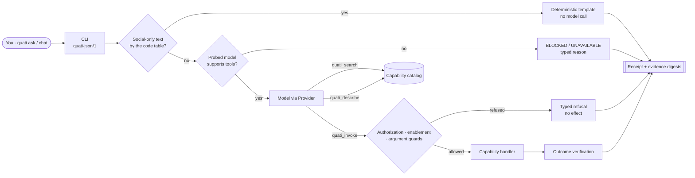

<p align="center">
  
</p>

<h1 align="center">Quati</h1>

<p align="center">
  <strong>An executive secretary that takes responsibility for work — not just a chat window in front of other agents.</strong>
</p>

<p align="center">
  
  
  
  
  
  
</p>

<p align="center">
  <a href="#what-quati-is">What it is</a> ·
  <a href="#quick-start">Quick start</a> ·
  <a href="#model-providers">Providers</a> ·
  <a href="#how-a-request-flows">Architecture</a> ·
  <a href="#live-qualification">Live qualification</a> ·
  <a href="#project-status">Status</a> ·
  <a href="#start-here-normative-reading-order">Docs</a>
</p>

---

## What Quati is

Quati interprets a request, starts safe work, asks only questions that are worth asking, manages
concurrent commitments, speaks up at the right moment, restores old context, checks outcomes and
hands specialist execution to interchangeable adapters.

It is designed to stay useful on **small, inexpensive models**. Stronger models are optional and are
used only for decisions that need them.

<table>
<tr>
<td width="50%" valign="top">

**🛡️ A protected kernel**

Prompts, operators and self-improvement agents can never switch these off:

- identity and tenant
- authorization **before** any effect
- durable commitments
- a transactional or reconcilable outbox
- evidence integrity and an audit trace
- versioned behavior policy

</td>
<td width="50%" valign="top">

**🔎 Capability discovery**

The model does not get a hard-coded tool list. Quati gives it four tools:

- `quati_search`
- `quati_describe`
- `quati_invoke`
- `quati_status`

The model finds the capability itself. Each call passes authorization, enablement and argument guards.

</td>
</tr>
<tr>
<td valign="top">

**🧾 Evidence**

Every answer carries a receipt. What it holds depends on the path:

- **Greeting** (answered by the application, no model call): the code and asset digests, the request and
  output hashes, the request and trace ids, a hash of the principal, status and result kind.
- **Model path**: all of the above, plus the observed model identity, the prompt, tool-schema, catalog,
  configuration and statechart digests, the tool trajectory, and token usage and cost when the provider
  reports them.

Receipts are unsigned local files. No work is reported as done without a verified outcome.

</td>
<td valign="top">

**🔌 Any model provider**

Choose a provider by name:

- the Anthropic API
- OpenAI or any OpenAI-compatible endpoint, such as OpenRouter
- the `claude`, `codex` and `gemini` command-line tools, under your own sign-in

To add another vendor, write a small subclass.

</td>
</tr>
</table>

> **Terminal first.** Every capability is exercised and accepted through the `quati` command line,
> including the conversational `quati chat` session. No GUI, web UI or full-screen TUI work starts
> until every slice gate S00–S07 passes.

## Quick start

```bash
python3.12 -m venv .venv && . .venv/bin/activate
pip install -e '.[test]'          # add '.[live]' for the Anthropic / OpenAI SDK transports

quati init                        # create a private LOCAL identity (no provider call)
quati doctor                      # configuration vs. measured provider support
quati config validate             # identity, policy, provider and behavior package checks
quati ask "hi!"                   # deterministic greeting, no model call
```

Connect a model. This example uses your own signed-in Claude Code, so Quati never sees a key:

```bash
export QUATI_PROVIDER=claude_cli QUATI_MODEL=haiku QUATI_ALLOW_LIVE=1
quati models probe                # measure tools / structured output / timeout support live
quati capabilities --help         # install the synthetic S00 fixture capabilities
quati ask "When is my next appointment?"
quati chat                        # line-based conversational session
quati trace show REQUEST_ID       # the recorded receipt and decisions of one request
quati trace explain REQUEST_ID    # which capability was selected and why the others were not
```

Compile a behavior package. The package path is resolved against `--root` (default: the current
directory), so run these two from the repository root, or pass `--root /path/to/the/checkout`:

```bash
quati behavior validate examples/behavior/executive-secretary.yaml   # compile a behavior package
quati behavior render examples/behavior/executive-secretary.yaml     # its prompt preview and build receipt
```

Conversation rule in S00: Quati answers text that is social-only by its built-in table (greetings, thanks,
pleasantries; English and Portuguese only for now, other languages go to the model like any other text)
with application-owned text, and it displays no model-written
answers. Anything else ends in a verified capability result or in a typed refusal with a non-zero exit
code; "no installed capability fits" is such a refusal (exit 4), not a success.

All output is machine-readable `quati-json/1`: `status`, `data`, `error`, `evidence_refs`,
`next_action` and `uncertainties`.

## Model providers

| Transport | How it authenticates | Live status |
|---|---|---|
| `claude_cli` | the vendor's own `claude` executable, started with your sign-in; Quati holds no key | historically qualified for S00 on the sealed source; S01 requalification pending (run `gate8`, `claude-haiku-5-5`, 30/30 and 30/30) |
| `codex_cli` | the vendor's own `codex` executable, with your sign-in | transport exercised live on an earlier code digest; `gpt-6-luna` scored 29/30 on each case, below the gate |
| `anthropic` | Anthropic SDK, using a secret reference (`QUATI_API_KEY_ENV`) | ⏳ not verified externally |
| `openai` / `openai_compatible` | OpenAI SDK with an approved HTTPS base URL (e.g. OpenRouter) | ⏳ not verified externally |
| `gemini_cli` | the vendor's own `gemini` executable | ⏳ not verified externally |

Every model call goes through the `Provider` base class. It owns configuration checks, budgets,
retries, output validation and the live feature probe. The vendor executables run in an empty
temporary directory with an allow-listed environment. They never receive a copy of Quati's
environment.

**Adding a vendor** takes one subclass. For example, Grok through its OpenAI-compatible API:

```python
from quati.application.providers import register
from quati.adapters.providers.openai_compatible import OpenAICompatibleProvider

@register
class GrokProvider(OpenAICompatibleProvider):
    transport = 'grok'
    default_base_url = 'https://api.x.ai/v1'
    needs_endpoint = False        # the default URL above is used when QUATI_BASE_URL is unset
```

```bash
export QUATI_PROVIDER=grok QUATI_MODEL=grok-4 QUATI_API_KEY_ENV=XAI_API_KEY QUATI_ALLOW_LIVE=1
```

To add a provider from a separate package, declare it under the `quati.providers` entry-point group.
To add a new wire protocol, subclass `Provider` directly and implement `_complete()`.

## How a request flows



| Layer | Path | Responsibility |
|---|---|---|
| Domain | `src/quati/domain/` | typed core concepts and pure functions (social-text table, discovery filters, policy evaluation, statechart model); no SDK, DB or transport imports |
| Application | `src/quati/application/` | use cases, ports, the `Provider` base, the discovery tools, the context envelope and the `trace` use cases |
| Adapters | `src/quati/adapters/` | provider transports, local identity, capability store, policy gate, receipt (evidence) writer and reader, feature-report index, FTS ranking, fixture capabilities |
| Behavior | `src/quati/behavior/` | the behavior-package and statechart compiler, contract and capability-manifest validation, the content-addressed behavior store and the trusted policy loader |
| CLI | `src/quati/cli/` | commands, composition and rendering |

There is no ledger yet: durable commitments and the ledger adapters (SQLite, PostgreSQL) arrive with
slice S02. In S00 the persisted state is the request receipts and the capability registry audit log.

## Live qualification

S00-GATE-02 requires a **real model** to choose the right capability from a natural-language
request, without any hint, in **30 of 30** runs on each test case.

> **Historical S00 qualification** was established by run `gate8` of 2026-11-16 (`claude_cli`, observed
> model `claude-haiku-5-5`), bound to code digest
> `f9029dea81304be64ac528008e1e5021d628d1b32e9081bb329689daf5395db8` and accepted by two independent
> audits (`docs/audit/S00_GATE8_ACCEPTANCE_AUDIT_2026-11-16.md`, `docs/audit/S00_AUDIT5_RETEST_2026-11-16.md`).
> The current S01 working tree is not live-qualified: its source/assets require requalification.
> Historical acceptance remains bound to the sealed S00 commit; it is not proof for changed code/assets.

| Case | What is tested | Run `gate8` (historical sealed S00 source) |
|---|---|---|
| CAP-01 | choose the right capability among confusable ones | 30/30 (Wilson 95% lower bound 0.886) |
| CAP-02 | find the next appointment; write-capable decoys stay unused | 30/30 |
| CAP-03 | a disabled capability is never invoked | passed |
| CAP-05 | an unprobed model is refused | passed |
| DOCTOR | `quati doctor --probe` measures the provider live | passed |
| SOC-01 | a greeting triggers no work | 328/328 |
| WRITE-01 | a requested write is refused before any handler runs | 10/10 |

Limits of this evidence, as the audits recorded them:

- CAP-02 presented a single eligible candidate in all 30 runs; the choice between similar candidates is
  shown by CAP-01 only.
- 2 of the 60 CAP passes used one logged continuation prompt.
- The paraphrase sets were also used while the prompts were iterated; held-out sets exist and were not run.
- The SOC-01 classification-timeout leg was not run live (the product has no public fault knob); it is
  covered by a child-process test with a scripted provider.
- On the public path the write was refused by the discovery guards; the policy gate's own denial is proven
  by a test on the composed gate, not live.
- The model identity is the one the vendor command-line tool reports.

What the extended harness (`tests/evals/`) checks, in code and with no model in the grading:

- CAP-01 / CAP-02: the search → describe → invoke order, exact arguments, no gold-label leakage into the
  prompt, a recorded and randomized candidate order, zero unauthorized effects; for CAP-02 also the
  `quati trace explain` answer, with the alternatives the oracle names
- SOC-01: table greetings answered with no model call and identically in every provider state; for text
  the model classifies, only a typed refusal or an executed and verified read passes, with the exit code
  of its status
- WRITE-01: no write handler executes and the answer is not a success
- before any spend: the code digest, the asset files, the product's own `doctor` identity, the datasets
  and the git state are pre-registered, and a gate run is refused on a dirty working tree
- after the run: every receipt and every `doctor` answer must carry the pre-registered digests

A gate whose required leg did not run is reported as `PASS_WITH_NOT_RUN_LEGS`, never as `PASS`. The
harness never seals a gate: its verdict is input for an independent audit.

Rerun the qualification (this spends real money on your sign-in):

```bash
.venv/bin/python tests/evals/run_live_eval.py --transport claude_cli --model haiku --estimate-only   # free: plan, calls, cost
.venv/bin/python tests/evals/run_live_eval.py --dry-run-scripted \
    --accept-not-run f_classification_timeout                                    # free: scripted model, no network
.venv/bin/python tests/evals/run_live_eval.py --transport claude_cli --model haiku --workers 4 --label gate8 \
    --accept-not-run f_classification_timeout --confirm-spend                    # paid; needs a clean git tree
```

The paid run is refused while the working tree has changed tracked files, or untracked files that are not
named with `--allow-untracked PATH`. `--accept-not-run f_classification_timeout` records that the SOC-01
timeout leg cannot run live: the product has no public switch that makes a provider time out.

Evidence is written under `evidence/S00/T05-*`. It holds a pre-registration file, written before the
first call, one JSON file per case and an index with the verdict of each gate.

## Project status

| | |
|---|---|
| **Current slice** | S00 — local CLI, provider layer, capability discovery |
| **Implemented** | `init`, `doctor`, `config validate`, `ask`, `chat`, `models probe`, `behavior validate` / `render`, `trace show` / `explain`, capability registry (synthetic fixtures), 6 provider transports |
| **S01 foundation** | T01 contribution accepted: typed classification and receipt-coordinated process-only conversation revision; S01 gates and current real-model qualification remain pending |
| **Arrives in S02** | `status`, `tell`, `approve`, `deny`, `approvals`, `trace export` / `replay` (they return `UNSUPPORTED` today) |
| **Live qualification** | historical run `gate8` on the sealed S00 source; S00 accepted (2026-11-17); changed S01 source/assets not yet live-qualified |
| **Tests** | 2247 passed, 0 failing, 10 skipped (2026-11-16, sealed commit; the skips are the opt-in live evaluations and smokes and one wheel-build leg) · coverage 99.87% overall, 100% line and branch in `domain/` and `behavior/` |
| **Specification** | 31 module PRDs · 15 RFCs · 16 ADRs · 35 work packages across slices S00–S07 |
| **Canonical state** | `docs/implementation/implementation_state.json` (revision-checked writes only) |

Delivery follows **SDD → TDD → EDD**. The specification comes first, then discriminating tests
(each with a captured red run before any source change), then immutable, redacted evidence.
Independent adversarial audits run before a delivery is accepted.

## Start here (normative reading order)

1. `AGENTS.md` — instructions for any coding agent.
2. `docs/vision/PRODUCT_PRD.md` — what to build and what must **not** be built.
3. `docs/vision/MODULE_MAP.md` and `docs/prds/M01.md` … `M31.md` — 31 bounded responsibilities.
4. `docs/trd/TECHNICAL_REFERENCE.md` — architecture, technology, portability and interfaces.
5. `docs/rfcs/RFC-010_BEHAVIOR_COMPILER.md`, `RFC-011_STATECHART_MODEL.md`, `RFC-012_SMALL_MODEL_CONTEXT.md` — how behavior is produced from configuration.
6. `docs/implementation/ROADMAP.md`, `docs/implementation/SLICES/` and `docs/implementation/implementation_state.json` — delivery order and resume state.
7. `docs/testing/TEST_STRATEGY.md`, `docs/testing/RISK_COVERAGE_REPORT.md` and `docs/testing/LIVE_MODEL_BENCHMARK.md` — test obligations and proof levels.
8. `docs/redteam/OVERALL_RED_TEAM.md` — cross-cutting blockers and per-module attack sheets.
9. `docs/governance/LOG.md` — every decision, defect, debt item and exception, append-only.

## Critical constraints

- **English only** for prompts, specifications, code, comments and structured events. Replies to
  end users follow the user's language.
- **No GUI or web application** in this release; CLI and worker only.
- **Ledger-driven worker** (SQLite LOCAL; PostgreSQL contract-tested) behind a minimal
  `DurableRunner` port (ADR-015). This is a design constraint for slice S02; no ledger or worker exists yet.
- **Never equate configuration with implementation.** Never treat a passing schema check or mock
  as live intelligence, durable execution or provider proof. Unverified items are reported as
  `NOT_VERIFIED_EXTERNAL`.
- **Never hard-code the target capability** in a prompt. Discovery must be spontaneous.
- **Always produce redacted evidence**: requirement ID, test source, version, observed result,
  timestamp and proof tier.
- **No Docker requirement** on personal machines.
- **A prompt can never grant privileges**, bypass approval or rewrite kernel invariants.

## Brand

<p>
  
  
</p>

The brand assets live in `docs/brand/`:

- the master logo
- the mascot head
- the wordmark
- a social preview (1280×640) and the banner
- favicons from 16 to 512 px, with `favicon.ico` and `apple-touch-icon.png`

---

<p align="center"><sub>Quati — the coati: curious, organized and always foraging for the right thing.</sub></p>
